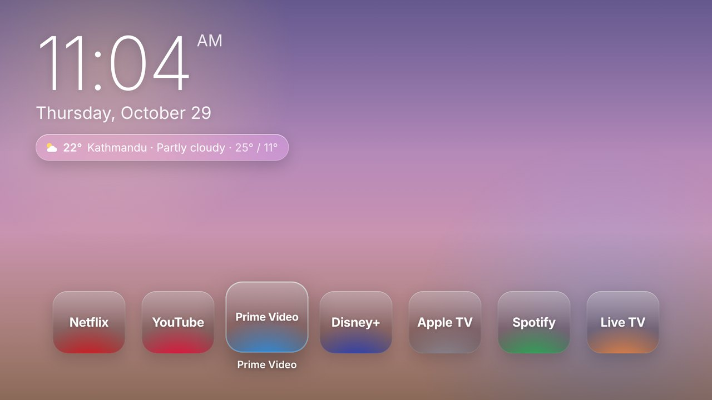
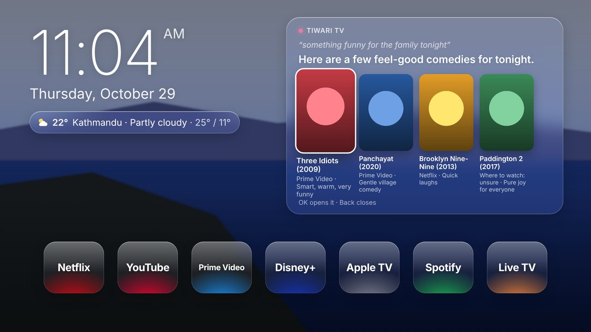

# Tiwari TV

A glassy home screen for our LG TV, with a few things the TV can't do on its own:

- **Glass home screen:** a big clock, the date and the Nepali date, Kathmandu's weather, festival and birthday countdowns, and frosted-glass app tiles that glow in each app's color.
- **Notes from your phone,** from anywhere: they pop up on the TV, then wait in the corner for a day.
- **A family photo frame:** photos from your phones play full screen when nobody's using the TV.
- **Your own background:** send a photo (or a color) from your phone. Light and dark follow the sunset, or you choose.
- **An assistant:** "Hey TV, open Netflix" or "Hey TV, something funny for the family tonight". It opens apps, or shows picks you open with OK. The answer comes back to your phone too.





It's an LG webOS app, installed with LG's own developer tools ([`@webos-tools/cli`](https://www.npmjs.com/package/@webos-tools/cli)).

## Set it up (once)

**On the TV:** open the LG Content Store and install **Developer Mode**. Sign in with a free LG developer account
(webostv.developer.lge.com), turn on **Dev Mode Status** (the TV restarts), then turn on **Key Server**.

**On your Mac** (Node.js needed: `brew install node`):

```
git clone https://github.com/JoeTiw/my-tv.git
cd my-tv
bash scripts/tv.sh setup 192.168.1.50
```

It creates `app/config.js` for your settings, gets LG's tools, and asks for the passphrase the TV shows in Developer Mode.

**Your keys** go in `app/config.js`, which never goes to GitHub:

| Setting | What it's for | Where to get it |
|---|---|---|
| `channel` | Your private phone channel (setup makes one and prints its link) | Keep it secret: anyone who knows it can send to the TV |
| `claudeKey` | The assistant | console.anthropic.com → API keys. Set a monthly spending limit there: the key lives on the TV. |
| `tmdbKey` | Posters on the assistant's picks (optional) | themoviedb.org → Settings → API |

## Sealed messages

Everything on your phone channel is encrypted with your family's own key (`secret` in `app/config.js`, made by
setup): notes, photos, questions, the TV's answers and the helper's messages. ntfy.sh only carries data nobody else
can read, and the TV and the helper ignore anything not sealed with your key, so even someone who learned your
channel name couldn't send to the TV or use your Claude key. The phone gets the key with its link (the part after
`#`, which never leaves the phone). It uses [TweetNaCl](https://tweetnacl.js.org) (public domain): XSalsa20 and
Poly1305, the same "secretbox" many messaging apps rely on.

An older setup without a key: `bash scripts/tv.sh lock`, then install, helper, autorenew and phone again (it tells
you). ntfy's own app and page can't send to a sealed TV; use the remote page (or set `acceptPlain: true`).

## The Nepali calendar

Under the clock: today's Bikram Sambat date (in Devanagari too; `nepaliScript: false` for English letters only), and
pills for what's coming in the next weeks: festivals, Nepali New Year, and your own days. On the day, the pill
turns pink with a greeting ("Happy Tihar!", "Happy birthday, Ama!"). The assistant knows them too.

Add birthdays and other days to `events` in `app/config.js`:

```
events: [
  {name: "Ama's birthday", bs: '05-14', birthday: true},    // every year on Bhadra 14 (BS month-day)
  {name: "Papa's birthday", ad: '03-21', birthday: true},   // every year on March 21
  {name: 'Trip to Pokhara', date: '2026-12-20'}              // once
],
```

The festival dates come from the government's list of public holidays for 2083 (until mid-April 2027); the 2084 list
gets added when it's published, around April 2027. The BS month lengths (2080 to 2090) are from
[nepali-date-converter](https://github.com/subeshb1/Nepali-Date) (MIT) and match every date in the 2083 list.

## The assistant

Send `Hey TV, ...` from the phone page (or dictate it). It knows the TV's apps, the time, the weather today and
tomorrow, the Nepali calendar, and what it has learned about your family. It can:

- **open an app**: "Hey TV, open YouTube";
- **recommend**: "Hey TV, something funny for the family", as cards; OK opens the title's app;
- **play a trailer** on YouTube: "Hey TV, show me the trailer for Panchayat" (needs the TMDB key);
- **remember** what you tell it: "Hey TV, we loved Panchayat", "Ama doesn't like horror"; later picks use it.
  "Hey TV, forget what you know about us" clears it. It's kept on the TV only;
- **answer questions about now**, looking them up on the web: cricket scores, the news, the rupee rate
  (about $0.01 a search; `webSearch: false` turns it off; an account without web search just answers without it);
- **switch the theme**, and **make tonight's picks again**.

Netflix and Prime Video can only be opened to their home screens: they don't take a title from other apps.

**Tonight's picks:** once a day, four titles chosen for your family appear above the dock, with pictures. ▲ from the
apps reaches them, OK opens one (and it's remembered, so it isn't suggested again). `picks: false` turns them off.

## Greeting and language

Above the clock, a greeting for the time of day ("Good evening", or "Good evening, Tiwari family" with `familyName`
in `app/config.js`). The phone page's **The look** card switches the TV between **English** and **नेपाली**: in Nepali the
greeting (शुभ प्रभात, शुभ सन्ध्या…), the clock (in Devanagari digits, with बिहान, दिउँसो, बेलुका, राति), the dates, the
weather, the festivals and countdowns, the notes' times and the assistant's answers are all in Nepali. Give your
events a Nepali name with `nameNe` (and `personNe` for a birthday greeting). `language: 'ne'` in `app/config.js`
starts it in Nepali; from ntfy, `/lang ne` or `/lang en`.

## The photo frame

On the phone page, **Photo frame → Add photos** (several at once). When nobody has touched the remote for a few
minutes (`frameAfter` in `app/config.js`, 3 by default), Tiwari TV shows them full screen, one after another with a
slow drift, the clock and the Nepali date on top, and who sent each one. Any button goes back to the home screen.
**Show it now**, **Stop** and **Empty the frame** do what they say; from ntfy, send a photo with the words `/frame`.

The TV keeps its own copies (up to 60; the oldest go first), but ntfy deletes files after a few hours, so the TV
needs Tiwari TV open within that time to pick new photos up. While the frame shows, Tiwari TV asks LG's own
screensaver to wait, the way Kodi does; if your TV still brings its screensaver, turn it off or lengthen it in the
TV's settings (on many models: Settings → General → OLED Care or Screen Saver).

## Install (and after every change)

```
bash scripts/tv.sh install
```

Developer Mode lasts about 40 days, then the TV removes developer apps. Let your Mac renew it by itself:

```
bash scripts/tv.sh autorenew
```

Run it with the TV on. Your Mac then checks every hour; about every 25 days, when the TV is on and showing
Tiwari TV (so nobody's show is interrupted), it renews and brings Tiwari TV straight back. If it hasn't had a chance
by day 33, a note on the TV and your phone asks you to press **EXTEND** in Developer Mode. What it did is in
`~/.tiwari-tv/renew.log`; `bash scripts/tv.sh autorenew off` stops it.

## Use it from your phone

**The Tiwari TV remote page** (`remote/`) has buttons that open the TV's apps, a "Hey TV" box (with a mic where the
phone's browser can listen), one-tap notes, photos, colors and the theme, and the TV's answers like a chat.

1. Put the page online once: on github.com, open the repository's **Settings → Pages**, choose **Deploy from a
   branch**, **main**, **/ (root)**, and save. (Pages is free for public repositories.)
2. Get your private link: `bash scripts/tv.sh phone`. Open it on your phone, then **Share → Add to Home Screen**.
   The channel is in the part after `#`, which never leaves your phone; the page remembers it and takes it out of
   the address bar.

The TV keeps a live connection to the channel, so what you send arrives in about a second.

### The helper at home: volume, buttons and more, even while Netflix is playing

LG pauses Tiwari TV while another app is in front, so for the **Remote** buttons a computer at home does the work:
it listens to your channel and talks to the TV over the home Wi-Fi (the same connection LG's ThinQ app uses).

```
bash scripts/tv.sh helper
```

Run it with the TV on: the TV asks once to allow **Tiwari TV Helper**; accept it with the remote. After that, while
this Mac is awake and on the home Wi-Fi:

- **Volume, mute, play, pause and back** from the phone, whatever is on screen;
- **Tiwari TV** brings Tiwari TV back to the front (from YouTube, Netflix, anywhere);
- the app buttons work while another app is open;
- notes pop up as a small TV notification while someone's watching something else;
- "Hey TV" while another app is open brings Tiwari TV forward to answer;
- **the dock shows your TV's own apps with their own icons**: newer LG TVs won't tell a Developer Mode app which
  apps they have, so the helper asks the TV and sends Tiwari TV the list and icons (again whenever they change, and
  whenever Tiwari TV finds it has none and asks). Still only names on the tiles? `bash scripts/tv.sh apps` (TV on)
  shows each app, where the TV keeps its icon, and whether the helper could fetch it, with the TV's address hidden.
  Newer LG firmware won't show the helper's main pairing the list of apps (`401 insufficient permissions`), so the
  helper pairs a second time, only to read that list: `bash scripts/tv.sh helper` asks the TV once more; press Accept.
- **your order for the apps**: hold OK on a tile to pick it up, ◀ ▶ to carry it, OK to put it down. Or on the phone,
  Arrange on "Open on the TV", then tap the left or right side of an app. New apps join at the end.

`~/.tiwari-tv/helper.log` shows what it did; `bash scripts/tv.sh helper off` stops it. Without the helper, everything
else still works; the phone page says when the helper isn't answering.

Every one of these is also a typed command (the remote page sends them sealed):

| Send | The TV |
|---|---|
| any text | shows it as a note |
| a photo | makes it the background |
| `Hey TV, ...` or `TV, ...` | asks the assistant |
| `/open netflix` (an app id or name) | opens that app |
| `/bg #ffb3c6` · `/bg <image link>` · `/bg off` | a color, a picture from the web, or the normal sky |
| `/theme dark` · `light` · `auto` | the look |
| `/lang ne` · `/lang en` | the TV in Nepali or English |
| `/clear` | takes the notes away |
| `/vol up` · `/vol down 3` · `/vol 20` · `/mute` | the volume (needs the helper) |
| `/key play` · `pause` · `back` · `home` | a remote button (needs the helper) |
| `/tiwari` | brings Tiwari TV to the front (needs the helper) |

Messages pass through ntfy.sh, a free public relay, sealed (see below), and stay there for a few hours.

## On the TV

Arrows move, **OK** opens, **Back** closes the assistant or the newest note.

## Look at it on your computer

```
bash scripts/tv.sh preview
```

Then open http://localhost:8000: arrows, Enter and Escape act as the remote, and a stand-in list of apps opens nothing.

## How it's built

Plain HTML, CSS and JavaScript (ES5, for older LG TVs), no frameworks:

| File | What it does |
|---|---|
| `app/js/home.js` | clock, dock, focus and remote keys, day/night, background |
| `app/js/inbox.js` | messages from the phone (ntfy.sh, live) |
| `app/js/seal.js`, `helper/seal.mjs` | sealing everything on the channel (TweetNaCl, in `js/vendor`) |
| `remote/index.html` | the phone's remote page (GitHub Pages) |
| `app/js/assistant.js` | the assistant (Claude API, web search), its memory, cards and trailers (TMDB) |
| `app/js/picks.js` | tonight's picks above the dock |
| `app/js/weather.js` | weather and sunset (Open-Meteo, no key) |
| `app/js/lang.js` | the words on the TV, in English and Nepali |
| `app/js/calendar.js` | the Nepali date, festivals, birthdays |
| `app/js/frame.js` | the photo frame |
| `app/js/platform.js` | the TV's apps and opening them (webOS Luna) |
| `helper/helper.mjs` | the helper at home: volume, buttons, apps and notes while other apps play (lgtv2) |
| `scripts/tv.sh` | setup, install, preview, the phone link, the helper and Developer Mode renewal |
